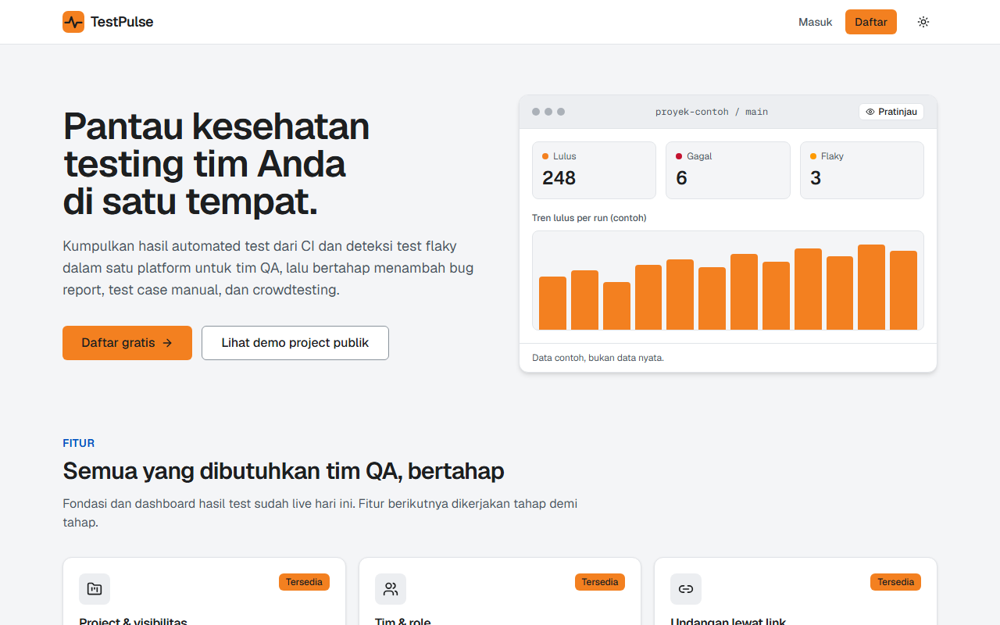
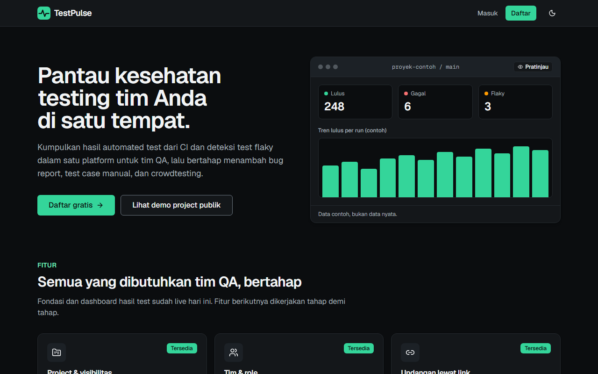
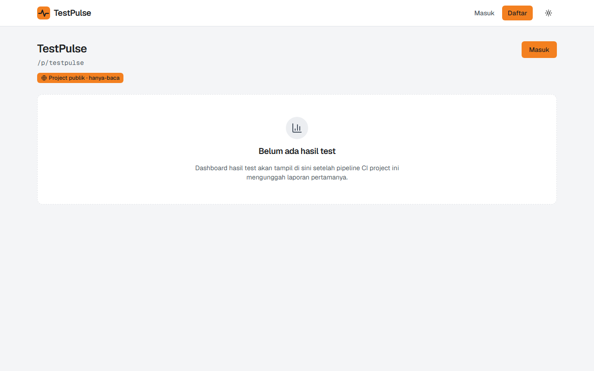
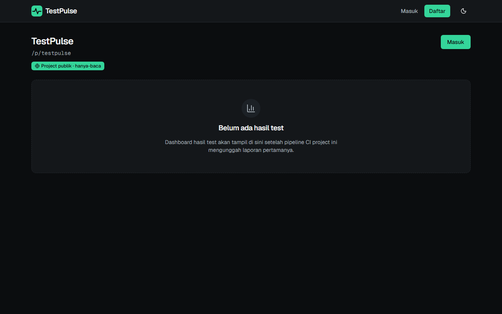
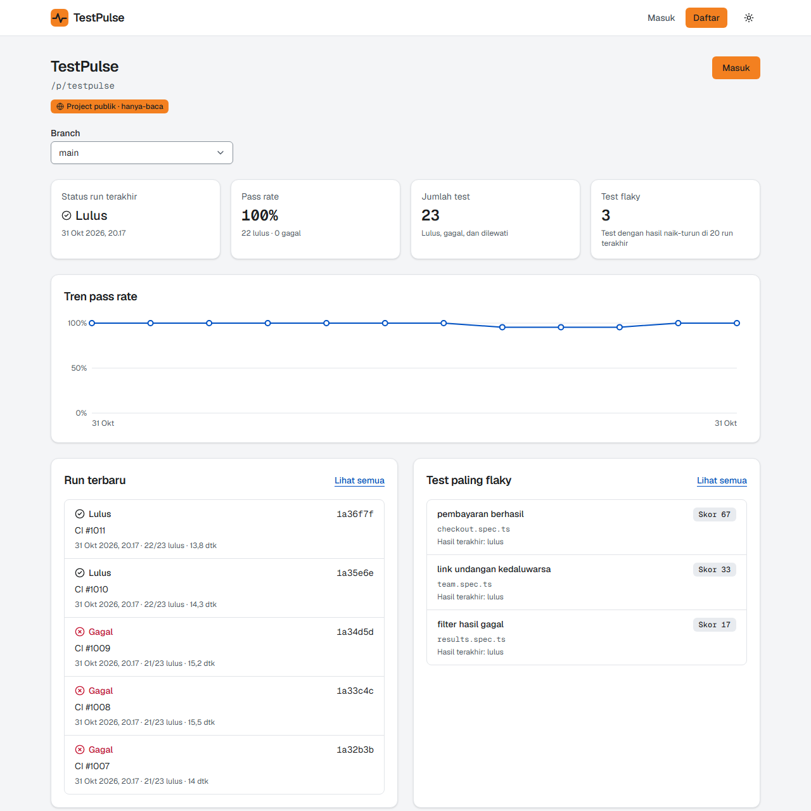
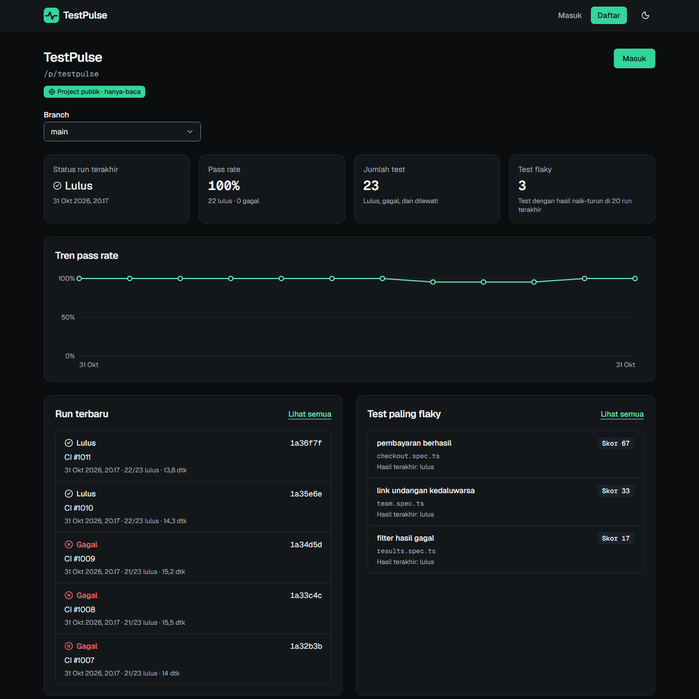
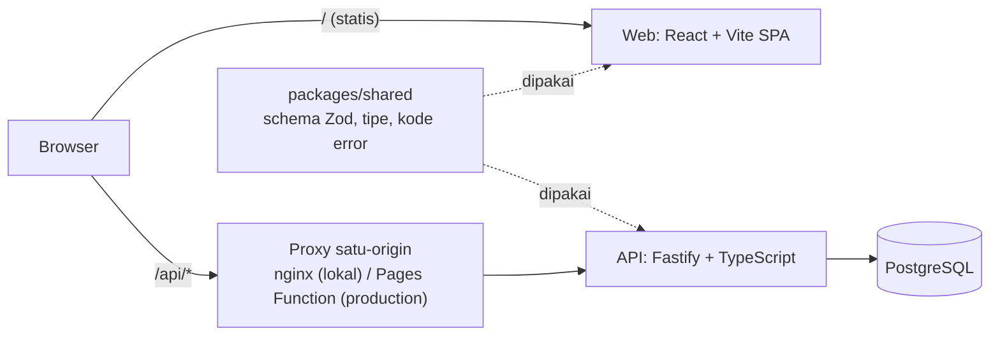

# TestPulse

[](https://github.com/Safeqq/testpulse/actions/workflows/ci.yml)

**TestPulse** adalah aplikasi web untuk tim QA/dev: satu tempat untuk memantau kesehatan testing, mulai dari hasil automated test dan deteksi test flaky, project dan tim, hingga (di tahap berikutnya) bug report, test case manual, dan crowdtesting. Kategori produk yang serupa: TestRail, Qase, ReportPortal, Allure TestOps.

- **Tahap 1** adalah fondasinya: akun, project (privat atau publik), tim dengan role `admin`/`tester`/`viewer`, dan undangan lewat link, lengkap dengan seluruh pipeline QA di bawahnya.
- **Tahap 2** menghadirkan fitur inti: CI mengunggah hasil test (JUnit XML) dengan token CI, lalu **dashboard** menampilkan tren, riwayat run, dan **test flaky** beserta skornya. Ada reporter CLI, gate performa k6, dan **dogfooding**: hasil test TestPulse sendiri dilaporkan ke project publik `testpulse` ([lihat di production](https://testpulse-d2p.pages.dev/p/testpulse)).

| | |
|---|---|
| Laporan test (Allure, live) | <https://safeqq.github.io/testpulse/> |
| CI (GitHub Actions) | [ci.yml](https://github.com/Safeqq/testpulse/actions/workflows/ci.yml) |
| Demo live | <https://testpulse-d2p.pages.dev> · project publik: <https://testpulse-d2p.pages.dev/p/testpulse> (API di Render free tier: request pertama setelah idle bisa ±1 menit) |
| Dokumen QA | [Strategi test](docs/TEST_STRATEGY.md) · [Test plan tahap 1](docs/test-plans/tahap-1.md) · [Test plan tahap 2](docs/test-plans/tahap-2.md) · [ADR](docs/adr/) |

## Kenapa proyek ini ada

TestPulse punya dua tujuan sekaligus:

1. **Produk yang berguna** untuk tim QA/dev.
2. **Portfolio QA/SDET**: TestPulse sendiri diuji dengan test pyramid lengkap yang berjalan otomatis di CI, dengan quality gate dan laporan publik.

Sejak tahap 2 **hasil test TestPulse dilaporkan ke TestPulse itu sendiri** (dogfooding): setelah setiap deploy, [deploy.yml](.github/workflows/deploy.yml) mengunggah JUnit dari run CI yang memicunya ke project publik `testpulse`, sehingga dashboard kualitas yang nyata bisa dilihat lewat <https://testpulse-d2p.pages.dev/p/testpulse> tanpa perlu mendaftar. Dashboard di production terisi setelah pemilik repo memasang secret `TESTPULSE_TOKEN` (langkahnya ada di [docs/deploy.md](docs/deploy.md), Langkah 12).

## Tampilan

Tampilan memakai Tailwind CSS v4 dan komponen shadcn/ui dengan dua tema: **terang** (terinspirasi gaya dashboard Cloudflare: abu muda dan aksen oranye) dan **gelap** (terinspirasi gaya Neon: hampir hitam dan aksen mint). Ini inspirasi gaya, bukan penyalinan logo atau aset merek mana pun. Tema dipilih lewat tombol di header: **Sistem** (default, mengikuti pengaturan perangkat), **Terang**, atau **Gelap**; pilihan disimpan di browser dan diterapkan sebelum halaman tampil, sehingga tidak berkedip. Semua ini berjalan di bawah CSP ketat tanpa `unsafe-inline` ([ADR 0003](docs/adr/0003-tailwind-shadcn.md)).

Pengunjung yang belum masuk melihat **landing page** di `/` (sebelumnya langsung dialihkan ke halaman masuk); pengguna yang sudah masuk melihat daftar project.

| | Terang | Gelap |
|---|---|---|
| **Landing page** (`/`) |  |  |
| **Project publik** (`/p/testpulse`), belum ada run |  |  |
| **Dashboard hasil test** (`/p/testpulse`, setelah run diunggah) |  |  |

Screenshot dibuat otomatis dari stack lokal (Docker Compose) oleh [`tests/scripts/screenshots.ts`](tests/scripts/screenshots.ts): `pnpm --filter @testpulse/tests screenshots` dengan `BASE_URL=http://localhost:8080`. Skrip itu membuat user, project publik, token CI, dan 12 run JUnit contoh (dibangun dengan helper `buildJUnit`) di database lokal yang kosong; datanya buatan, bukan hasil test sungguhan.

## Fitur Tahap 2: hasil test dan deteksi flaky

1. **Admin membuat token CI** di Pengaturan project, bagian **Token CI** (nilai `tp_...` tampil sekali; database hanya menyimpan hash-nya; maksimal 10 token aktif).
2. **CI mengunggah laporan JUnit XML** dengan token itu, lewat curl atau reporter CLI.
3. **Dashboard** (`/p/:slug`) menampilkan status run terakhir, pass rate, jumlah test, jumlah flaky, tren 30 run terakhir, run terbaru, dan test paling flaky. Ada juga daftar run, detail run (filter Gagal/Flaky/Semua), daftar flaky, dan riwayat 20 hasil per test. Project publik bisa dilihat siapa saja, tanpa login.

**Flaky** ([ADR 0004](docs/adr/0004-ingest-sinkron-dan-definisi-flaky.md)): test dianggap flaky bila skornya lebih dari 0. Skor dihitung dari 20 run terakhir branch itu yang memuat test tersebut: `round(100 x (jumlah pergantian lulus/gagal + jumlah hasil yang lulus setelah retry) / jumlah hasil)`, maksimal 100. Test yang gagal terus-menerus bukan flaky.

### Mengunggah dengan curl

```bash
curl -X POST "https://testpulse-d2p.pages.dev/api/v1/projects/<slug>/runs?branch=main&commit=<sha>&ciUrl=<url-run-ci>&name=<nama-run>" \
  -H "Authorization: Bearer $TESTPULSE_TOKEN" \
  -H "Content-Type: application/xml" \
  --data-binary @junit.xml
# 201 {"runId":"...","url":"https://.../p/<slug>/runs/<runId>","totals":{"total":..,"passed":..,"failed":..,"skipped":..,"flaky":..}}
```

`branch` wajib (1 sampai 200 karakter `A-Za-z0-9._/-`); `commit` (hex 7 sampai 40), `ciUrl` (http/https), dan `name` opsional. Batas: body 5 MB, 20.000 testcase per laporan, 60 unggahan per jam per token, dan 200 run terbaru per project disimpan. Hanya token Bearer yang diterima di endpoint ini (cookie sesi tidak), dan laporan dengan `<!DOCTYPE` ditolak.

### Mengunggah dengan reporter CLI

[`packages/reporter`](packages/reporter) menggabungkan beberapa file JUnit (path atau glob) menjadi satu laporan, memeriksa ukurannya, lalu mengunggahnya. Token dibaca dari environment `TESTPULSE_TOKEN` (tidak ada flag token) dan tidak pernah dicetak. Exit code: `0` berhasil, `1` unggah gagal, `2` argumen atau berkas salah.

```bash
pnpm --filter @testpulse/reporter build
TESTPULSE_TOKEN=tp_... node packages/reporter/dist/cli.js \
  --url https://testpulse-d2p.pages.dev --project <slug> --branch main \
  --commit "$(git rev-parse HEAD)" --ci-url "$RUN_URL" --name "CI #42" \
  'allure-results/junit-*.xml'
# Laporan terkirim (N berkas): 1171 test, 1170 lulus, 0 gagal, 1 dilewati, 0 flaky
```

Dogfooding memakai perintah yang sama di [deploy.yml](.github/workflows/deploy.yml).

## Highlights untuk recruiter

- **Matriks otorisasi dibangkitkan dari data.** [`authorization-matrix.ts`](tests/api/authorization-matrix.ts) mendefinisikan 6 aktor x endpoint yang terikat project (baris tabel spec bagian 7), dan [`authorization.spec.ts`](tests/api/authorization.spec.ts) menghasilkan satu test per kombinasi. Menambah role atau endpoint berarti menambah baris data.
- **Race condition dibuktikan, bukan diasumsikan.** Aturan "minimal satu admin" dijaga dengan `SELECT ... FOR UPDATE`; [test integrasi](apps/api/test/integration/members.int.test.ts) memaksa dua request paralel lolos pengecekan akses lebih dulu lalu memastikan hasilnya tepat satu sukses dan satu `409 LAST_ADMIN`.
- **Tidak membocorkan keberadaan project privat.** Project privat dan yang tidak ada menghasilkan `404` yang identik (badan respons dibandingkan sama persis).
- **Contract test web dan API** dengan Pact: consumer menulis kontrak, provider memverifikasinya terhadap API dan Postgres asli.
- **Integration test memakai Postgres asli** lewat Testcontainers, bukan mock.
- **Keamanan sebagai gate**: OWASP ZAP baseline (gagal jika ada temuan High), `pnpm audit`, Dependabot, serta test untuk CSRF, rate limit, hash token sesi/undangan, dan penyensoran token di log.
- **Rate limit tahan header IP palsu**: IP klien (header `x-tp-client-ip` dari Pages Function) hanya dipercaya jika header rahasia bersama (`PROXY_SECRET`) cocok; `X-Forwarded-For` tidak dipakai untuk kunci.
- **Paritas header keamanan** nginx (lokal) dan Cloudflare Pages (production) dijaga oleh test, agar yang dipindai ZAP sama dengan yang di-deploy.
- **E2E di 3 browser** (Chromium, Firefox, WebKit) dengan Page Object Model, custom fixtures, pengguna di context terpisah, dan pemeriksaan aksesibilitas axe di **tema terang dan gelap** pada landing, halaman masuk/daftar, daftar dan buat project, ringkasan, pengaturan, serta undangan.
- **Gate CSP di E2E**: setiap test gagal bila ada pelanggaran Content Security Policy (event dan console, gagal tertutup), sehingga tampilan baru terbukti tidak melonggarkan CSP production.
- **CI penuh dengan Allure**: lint, typecheck, unit + coverage gate, integration, contract, API + E2E (sharding), ZAP, laporan gabungan di GitHub Pages; deploy otomatis (menunggu revisi API baru aktif, lalu deploy web) diikuti smoke test production.
- **Dogfooding.** TestPulse memantau kualitas dirinya sendiri: JUnit dari CI diunggah ke project publik `testpulse` di production setelah smoke lulus, tanpa menggagalkan deploy bila token tidak ada ([ADR 0004](docs/adr/0004-ingest-sinkron-dan-definisi-flaky.md), [test plan tahap 2](docs/test-plans/tahap-2.md)).
- **Rumus flaky dibuktikan dua kali.** Skor dihitung sebagai fungsi murni dan sebagai query SQL; integration test dengan Postgres asli menuntut keduanya identik pada pola hasil acak-terkendali.
- **Ingest yang aman dan berbatas.** Token CI di-hash dan hanya berlaku untuk upload, parser menolak `<!DOCTYPE` (XXE), batas ukuran/jumlah/laju/retensi diuji, dan upload paralel tidak menghasilkan duplikat.
- **Reporter CLI sebagai consumer kontrak kedua** (Pact) dan **gate performa k6** (p95 upload < 1500 ms, p95 baca < 300 ms) di CI.
- **Dokumentasi QA nyata**: strategi test (termasuk apa yang sengaja tidak diuji), test plan dengan rujukan ke test, dan ADR.

## Roadmap

| Tahap | Isi | Status |
|---|---|---|
| **1** | Fondasi: akun, project, tim dan role, undangan, seluruh pipeline QA | ✅ Selesai dan live (status CI: lihat badge di atas) |
| **2** | Dashboard hasil test, deteksi flaky, reporter CLI, token CI, dogfooding, test performa (k6) | ✅ Selesai dan live (dashboard production terisi setelah `TESTPULSE_TOKEN` dipasang) |
| 3 | Bug tracker (bug dari test yang gagal), visual regression | Direncanakan |
| 4 | Test case management dan test run manual, mutation testing | Direncanakan |
| 5 | Crowdtesting: test cycle publik, crowd tester mengirim bug, triase, reputasi dan leaderboard (aplikasi berupa link, tanpa pembayaran) | Direncanakan |
| 6 (opsional) | Aplikasi desktop Electron (notifikasi build gagal, tray) yang diuji dengan Playwright | Opsional |

Setiap tahap melewati siklus spec, rencana implementasi, lalu implementasi. Spec: [tahap 1](docs/superpowers/specs/2026-10-23-testpulse-tahap1-design.md), [tahap 2](docs/superpowers/specs/2026-10-28-testpulse-tahap2-design.md).

## Arsitektur

Modular monolith: satu API Fastify + PostgreSQL, SPA React, dan paket bersama untuk schema. Alasannya ada di [ADR 0001](docs/adr/0001-modular-monolith.md); model sesi di [ADR 0002](docs/adr/0002-cookie-session.md); pilihan Tailwind + shadcn dan kendala CSP di [ADR 0003](docs/adr/0003-tailwind-shadcn.md); ingest sinkron dan definisi flaky di [ADR 0004](docs/adr/0004-ingest-sinkron-dan-definisi-flaky.md).



| Bagian | Teknologi | Production |
|---|---|---|
| API | Fastify, Drizzle ORM, Zod | Render (Docker, free tier; ada cold start sekitar 30 sampai 60 detik setelah idle) |
| Web | React, Vite, React Router, Tailwind CSS v4, shadcn/ui | Cloudflare Pages (+ Pages Function untuk `/api/*`) |
| Database | PostgreSQL | Neon (free) |

Browser hanya melihat satu origin sehingga cookie sesi `HttpOnly` aman dan first-party.

## Pipeline kualitas

Seluruh lapisan berjalan otomatis di [CI](.github/workflows/ci.yml); detail dan alasan tiap lapisan ada di [docs/TEST_STRATEGY.md](docs/TEST_STRATEGY.md).

| Lapisan | Tool | Lokasi |
|---|---|---|
| Unit (coverage domain >= 80%) | Vitest | `packages/shared/src`, `apps/api/src`, `apps/web/src`, `packages/reporter/src` |
| Integration (Postgres asli) | Vitest + Testcontainers | `apps/api/test/integration` |
| API + matriks otorisasi | Playwright `request` | `tests/api` |
| Contract (web dan reporter sebagai consumer) | Pact JS | `apps/web/test/contract`, `packages/reporter/test/contract`, `apps/api/test/contract` |
| E2E (3 browser) + aksesibilitas dua tema + gate CSP | Playwright (POM) + axe | `tests/e2e`, `tests/pages`, `tests/support` |
| Proxy dan paritas header | Vitest | `apps/web/test/functions` |
| Performa (gate p95 upload dan baca) | k6 | `tests/perf` |
| Security (0 temuan High) | OWASP ZAP, `pnpm audit`, Dependabot | `tests/security`, `.github/` |
| Smoke production (`@smoke`, read-only; termasuk dashboard `/p/testpulse`) | Playwright | `tests/smoke` |

Jumlah test per lapisan (snapshot per commit `0606543`, 2026-10-31; bisa bergeser) ada di [TEST_STRATEGY.md](docs/TEST_STRATEGY.md#jumlah-test-snapshot-per-commit-0606543-2026-10-31).

## Menjalankan secara lokal

Prasyarat: Node.js 24 (lihat `.nvmrc`), [pnpm](https://pnpm.io) 10, dan Docker (untuk Compose, Testcontainers, dan ZAP).

```bash
pnpm install
```

**Opsi A: seluruh stack dengan Docker Compose** (Postgres + API + web via nginx):

```bash
docker compose up -d --build --wait
# buka http://localhost:8080  (ganti port dengan WEB_PORT=9090)
docker compose down        # tambahkan -v untuk menghapus data
```

**Opsi B: mode pengembangan** (hot reload). Butuh Postgres di `localhost:5432` dengan kredensial yang sama seperti `.env.example` (Compose sengaja tidak membuka port Postgres ke host).

```bash
docker run -d --name tp-pg -e POSTGRES_USER=testpulse -e POSTGRES_PASSWORD=testpulse -e POSTGRES_DB=testpulse -p 5432:5432 postgres:17-alpine
cp .env.example .env
pnpm dev
# web: http://localhost:5173  ·  API: http://localhost:3000/api/health
```

Jika port 5432 sudah terpakai (misalnya Postgres bawaan mesin), petakan port lain (`-p 5433:5432`) dan ubah `DATABASE_URL` di `.env` ke `localhost:5433`. Migrasi berjalan otomatis saat API menyala.

Variabel lingkungan API: `DATABASE_URL`, `APP_ORIGIN`, `COOKIE_SECURE`, `PORT`, `RATE_LIMIT_MAX` dan `INGEST_RATE_LIMIT_MAX` (batas upload per jam per token, default 60; lihat [.env.example](.env.example)), serta `PROXY_SECRET` (opsional, hanya production). Cloudflare Pages Function memakai `API_ORIGIN` dan `PROXY_SECRET`. Penjelasan production ada di [docs/deploy.md](docs/deploy.md). Tidak ada secret di repo.

## Menjalankan test per lapisan

```bash
pnpm lint && pnpm typecheck                      # lint dan typecheck

pnpm test:unit                                   # unit: shared, api, web (proxy + paritas header), reporter, dan helper tests/
pnpm --filter @testpulse/api exec vitest run --project unit --coverage   # unit API + gate coverage domain

pnpm test:int                                    # integration (butuh Docker untuk Testcontainers)
pnpm test:contract                               # contract: consumer (web, reporter) lalu provider (API); butuh Docker
```

Test API dan E2E berjalan terhadap stack yang sudah hidup. Cara paling mirip CI: jalankan Compose (Opsi A), lalu arahkan `BASE_URL` ke sana.

```bash
docker compose up -d --build --wait
pnpm --filter @testpulse/tests exec playwright install chromium firefox webkit   # sekali saja

export BASE_URL=http://localhost:8080            # PowerShell: $env:BASE_URL = "http://localhost:8080"
pnpm --filter @testpulse/tests test:api          # API test + matriks otorisasi
pnpm --filter @testpulse/tests test:e2e          # E2E semua browser + axe
pnpm --filter @testpulse/tests exec playwright test --project e2e-chromium   # satu browser
pnpm --filter @testpulse/tests test:security     # unit test untuk gate ZAP
```

Tanpa `BASE_URL`, Playwright menyalakan `pnpm dev` sendiri (butuh Postgres seperti Opsi B, termasuk perintah `docker run` di atas).

**Performa (k6)**, terhadap stack Compose yang hidup (sama dengan job `perf` di [ci.yml](.github/workflows/ci.yml); image `grafana/k6` dijalankan di jaringan Compose):

```bash
BASE_URL=http://localhost:8080 node tests/perf/setup.mjs      # user, project, token, dan 55 run contoh (state di tests/perf/.state, tidak masuk git)
mkdir -p perf-results
docker run --rm --network testpulse_default -v "$PWD/tests/perf:/scripts:ro" -v "$PWD/perf-results:/results" \
  grafana/k6:1.3.0 run /scripts/ingest.js -e BASE_URL=http://web:8080 --summary-export /results/ingest-summary.json
# ganti ingest.js dengan read.js untuk skenario baca
```

**OWASP ZAP baseline** (terhadap stack Compose yang hidup; sama dengan job `zap` di [ci.yml](.github/workflows/ci.yml)):

```bash
mkdir -p zap && chmod 777 zap
docker run --rm --network testpulse_default -v "$PWD/zap:/zap/wrk:rw" \
  ghcr.io/zaproxy/zaproxy:stable \
  zap-baseline.py -t http://web:8080 -J report.json -r report.html -I
node tests/security/check-zap-report.mjs zap/report.json   # gagal jika ada temuan High
```

**Smoke production** (hanya membaca; butuh akun smoke di production, lihat [docs/deploy.md](docs/deploy.md)):

```bash
BASE_URL=https://<url-production> SMOKE_EMAIL=... SMOKE_PASSWORD=... SMOKE_PUBLIC_SLUG=... \
  pnpm --filter @testpulse/tests exec playwright test --project smoke
```

## Struktur proyek

```
apps/
  api/            Fastify + Drizzle; src/modules/{auth,projects,invitations,tokens,results}, test/{integration,contract}
  web/            React + Vite SPA; functions/ (Cloudflare Pages Function), test/{contract,functions}
packages/
  shared/         Schema Zod, tipe, enum role, kode error
  reporter/       CLI testpulse-report: menggabungkan dan mengunggah laporan JUnit
tests/
  api/            Playwright request + matriks otorisasi
  e2e/ pages/     Playwright E2E dan Page Object Model
  smoke/          Smoke test production (@smoke)
  perf/           Skenario k6 (ingest, read) dan penyiapan datanya
  security/       Gate hasil ZAP
  support/        Fixtures, klien API, factory data, helper axe, gate CSP
  scripts/        Skrip bantu (screenshot dokumentasi), bukan test
docs/
  TEST_STRATEGY.md   test-plans/   adr/   images/ (screenshot)   deploy.md   superpowers/ (spec dan rencana)
.github/          Workflow CI dan deploy, Dependabot
docker-compose.yml  render.yaml
```

## Deploy

Production memakai layanan gratis (Neon, Render, Cloudflare Pages) dan di-deploy otomatis oleh [deploy.yml](.github/workflows/deploy.yml) setelah CI hijau di `main`, diikuti smoke test. Setup satu kali ada di [docs/deploy.md](docs/deploy.md). Status saat ini: **live** di <https://testpulse-d2p.pages.dev>; smoke test production hijau setelah setiap deploy. Dogfooding (unggah hasil CI ke `/p/testpulse`) aktif setelah secret opsional `TESTPULSE_TOKEN` dipasang oleh pemilik repo.

## Keterbatasan yang diketahui

- Render free tier tidur saat idle; request pertama bisa lambat sekitar 30 sampai 60 detik.
- Tahap 1 sengaja tidak memuat reset password, verifikasi email, dan OAuth/2FA. Tahap 2 hanya menerima JUnit XML dan tidak memuat notifikasi, lampiran test, perbandingan dua run, atau mute test flaky; hanya 200 run terbaru per project yang disimpan.
- Unggahan diproses sinkron (ADR 0004): laporan sangat besar (mendekati 5 MB) memegang request lebih lama, terutama setelah cold start Render.
- Hal yang sengaja tidak diuji (performa, visual regression, mutation testing, dan lainnya) beserta alasannya: [TEST_STRATEGY.md bagian 6](docs/TEST_STRATEGY.md#6-sengaja-tidak-diuji-dan-alasannya).
