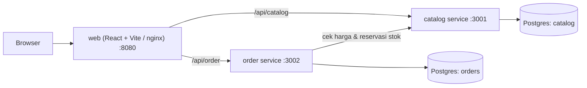

# ShopQA — Quality Platform End-to-End

Proyek portfolio QA/SDET: sebuah toko online kecil berbasis microservices yang menjadi **objek uji** untuk test pyramid lengkap — unit, integration, API, contract, E2E, visual, accessibility, performance, dan security — semuanya berjalan otomatis di CI/CD dengan quality gate.

> Aplikasinya sengaja dibuat kecil. Fokus proyek ini adalah **strategi dan otomasi testing-nya**.

## Status roadmap

| Fase | Isi | Status |
|---|---|---|
| 1 | Monorepo, service catalog & order, web storefront, docker-compose | ✅ |
| 2 | Unit test (Vitest) + integration test (Testcontainers), CI dasar | ⏳ |
| 3 | Framework E2E Playwright (POM, fixtures, test data factory) | ⏳ |
| 4 | API test + validasi schema + contract test (Pact) | ⏳ |
| 5 | Visual + accessibility test, sharding, laporan Allure di GitHub Pages | ⏳ |
| 6 | Performance test k6 + quality gate | ⏳ |
| 7 | Security scan OWASP ZAP, nightly regression, mutation testing | ⏳ |
| 8 | Dokumen QA (test strategy, test plan, bug report), README final | ⏳ |

## Arsitektur



| Komponen | Teknologi | Tanggung jawab |
|---|---|---|
| `services/catalog` | Fastify, PostgreSQL, Zod | Data produk & stok; reservasi stok atomik (anti-overselling) |
| `services/order` | Fastify, PostgreSQL, JWT, Zod | Login, perhitungan harga/promo/ongkir, pembuatan pesanan |
| `apps/web` | React 19, React Router, Vite | Storefront: produk → keranjang → login → checkout → konfirmasi |

## Menjalankan

### Dengan Docker (disarankan)

```bash
pnpm install
pnpm up        # docker compose up --build -d
```

Buka http://localhost:8080. Hentikan dengan `pnpm down`.

### Tanpa Docker (mode development)

Butuh PostgreSQL lokal dengan database `catalog` dan `orders`.

```bash
cp .env.example .env   # sesuaikan URL database
pnpm install
pnpm dev               # catalog :3001, order :3002, web :5173
```

### Akun demo

| Email | Password | Kegunaan |
|---|---|---|
| `demo@shopqa.dev` | `Demo123!` | Pengguna utama |
| `qa@shopqa.dev` | `Qa12345!` | Pengguna kedua untuk uji otorisasi |

## Aturan bisnis (dasar desain test case)

- Harga dalam rupiah (integer). Harga **selalu** diambil dari catalog, tidak pernah dari client.
- Jumlah per item: 1–10; maksimal 20 baris item per pesanan.
- **Ongkir** Rp15.000, **gratis** jika subtotal ≥ Rp250.000 (dihitung sebelum diskon).
- **Kode promo** (tidak peka huruf besar/kecil, spasi di-trim):

  | Kode | Diskon | Minimal belanja | Diskon maksimal |
  |---|---|---|---|
  | `HEMAT10` | 10% | Rp100.000 | Rp50.000 |
  | `MAHASISWA` | 15% | Rp200.000 | Rp75.000 |

- Jika reservasi stok salah satu item gagal, stok item lain yang sudah direservasi dikembalikan (kompensasi).
- Pesanan milik user lain mengembalikan **404** (bukan 403) agar keberadaannya tidak bocor.
- Login yang gagal selalu memberi pesan yang sama (mencegah user enumeration).

## API ringkas

| Method | Endpoint | Auth | Keterangan |
|---|---|---|---|
| GET | `catalog /products` | – | Daftar produk |
| GET | `catalog /products/:id` | – | Detail produk (404 `PRODUCT_NOT_FOUND`) |
| POST | `catalog /products/:id/reserve` | – | Kurangi stok (409 `INSUFFICIENT_STOCK`) |
| POST | `catalog /products/:id/release` | – | Kembalikan stok |
| POST | `order /auth/login` | – | Dapatkan JWT (401 `INVALID_CREDENTIALS`) |
| POST | `order /orders/quote` | – | Pratinjau total tanpa mengurangi stok |
| POST | `order /orders` | JWT | Buat pesanan (201) |
| GET | `order /orders` | JWT | Pesanan milik user |
| GET | `order /orders/:id` | JWT | Detail pesanan milik user |

Semua error berbentuk `{ "error": "KODE_ERROR", "message": "..." }`.
