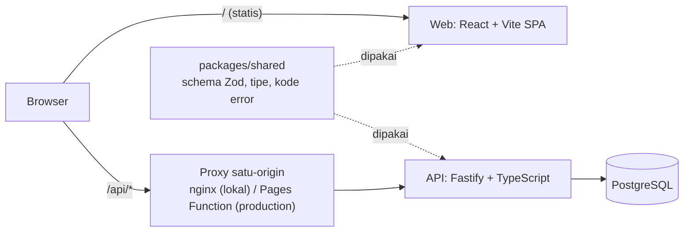

# TestPulse

[](https://github.com/Safeqq/testpulse/actions/workflows/ci.yml)

**TestPulse** adalah aplikasi web untuk tim QA/dev: satu tempat untuk memantau kesehatan testing, mulai dari hasil automated test, project dan tim, hingga (di tahap berikutnya) deteksi test flaky, bug report, test case manual, dan crowdtesting. Kategori produk yang serupa: TestRail, Qase, ReportPortal, Allure TestOps.

**Tahap 1 (dokumen ini)** adalah fondasinya: akun, project (privat atau publik), tim dengan role `admin`/`tester`/`viewer`, dan undangan lewat link, lengkap dengan seluruh pipeline QA di bawahnya.

| | |
|---|---|
| Laporan test (Allure, live) | <https://safeqq.github.io/testpulse/> |
| CI (GitHub Actions) | [ci.yml](https://github.com/Safeqq/testpulse/actions/workflows/ci.yml) |
| Demo live | Segera (belum ter-deploy; langkahnya di [docs/deploy.md](docs/deploy.md)) |
| Dokumen QA | [Strategi test](docs/TEST_STRATEGY.md) · [Test plan tahap 1](docs/test-plans/tahap-1.md) · [ADR](docs/adr/) |

## Kenapa proyek ini ada

TestPulse punya dua tujuan sekaligus:

1. **Produk yang berguna** untuk tim QA/dev.
2. **Portfolio QA/SDET**: TestPulse sendiri diuji dengan test pyramid lengkap yang berjalan otomatis di CI, dengan quality gate dan laporan publik.

Rencananya, mulai tahap 2 **hasil test TestPulse dilaporkan ke TestPulse itu sendiri** (dogfooding). Project TestPulse akan disetel publik sehingga dashboard kualitas yang nyata bisa dilihat lewat link tanpa perlu mendaftar.

## Highlights untuk recruiter

- **Matriks otorisasi dibangkitkan dari data.** [`authorization-matrix.ts`](tests/api/authorization-matrix.ts) mendefinisikan 6 aktor x semua endpoint project, dan [`authorization.spec.ts`](tests/api/authorization.spec.ts) menghasilkan satu test per kombinasi. Menambah role atau endpoint berarti menambah baris data.
- **Race condition dibuktikan, bukan diasumsikan.** Aturan "minimal satu admin" dijaga dengan `SELECT ... FOR UPDATE`; [test integrasi](apps/api/test/integration/members.int.test.ts) memaksa dua request paralel lolos pengecekan akses lebih dulu lalu memastikan hasilnya tepat satu sukses dan satu `409 LAST_ADMIN`.
- **Tidak membocorkan keberadaan project privat.** Project privat dan yang tidak ada menghasilkan `404` yang identik (badan respons dibandingkan sama persis).
- **Contract test web dan API** dengan Pact: consumer menulis kontrak, provider memverifikasinya terhadap API dan Postgres asli.
- **Integration test memakai Postgres asli** lewat Testcontainers, bukan mock.
- **Keamanan sebagai gate**: OWASP ZAP baseline (gagal jika ada temuan High), `pnpm audit`, Dependabot, serta test untuk CSRF, rate limit, hash token sesi/undangan, dan penyensoran token di log.
- **Rate limit tahan header IP palsu**: IP klien (header `x-tp-client-ip` dari Pages Function) hanya dipercaya jika header rahasia bersama (`PROXY_SECRET`) cocok; `X-Forwarded-For` tidak dipakai untuk kunci.
- **Paritas header keamanan** nginx (lokal) dan Cloudflare Pages (production) dijaga oleh test, agar yang dipindai ZAP sama dengan yang di-deploy.
- **E2E di 3 browser** (Chromium, Firefox, WebKit) dengan Page Object Model, custom fixtures, pengguna di context terpisah, dan pemeriksaan aksesibilitas axe pada halaman masuk/daftar, daftar dan buat project, ringkasan, pengaturan, serta undangan.
- **CI penuh dengan Allure**: lint, typecheck, unit + coverage gate, integration, contract, API + E2E (sharding), ZAP, laporan gabungan di GitHub Pages; deploy otomatis (menunggu revisi API baru aktif, lalu deploy web) diikuti smoke test production.
- **Dokumentasi QA nyata**: strategi test (termasuk apa yang sengaja tidak diuji), test plan dengan rujukan ke test, dan ADR.

## Roadmap

| Tahap | Isi | Status |
|---|---|---|
| **1** | Fondasi: akun, project, tim dan role, undangan, seluruh pipeline QA | ✅ Selesai (status CI: lihat badge di atas), kecuali deploy live (menunggu setup layanan hosting) |
| 2 | Dashboard hasil test, deteksi flaky, reporter CLI, project token, test performa (k6) | Direncanakan |
| 3 | Bug tracker (bug dari test yang gagal), visual regression | Direncanakan |
| 4 | Test case management dan test run manual, mutation testing | Direncanakan |
| 5 | Crowdtesting: test cycle publik, crowd tester mengirim bug, triase, reputasi dan leaderboard (aplikasi berupa link, tanpa pembayaran) | Direncanakan |
| 6 (opsional) | Aplikasi desktop Electron (notifikasi build gagal, tray) yang diuji dengan Playwright | Opsional |

Setiap tahap melewati siklus spec, rencana implementasi, lalu implementasi. Spec tahap 1: [docs/superpowers/specs](docs/superpowers/specs/2026-10-23-testpulse-tahap1-design.md).

## Arsitektur

Modular monolith: satu API Fastify + PostgreSQL, SPA React, dan paket bersama untuk schema. Alasannya ada di [ADR 0001](docs/adr/0001-modular-monolith.md); model sesi di [ADR 0002](docs/adr/0002-cookie-session.md).



| Bagian | Teknologi | Production |
|---|---|---|
| API | Fastify, Drizzle ORM, Zod | Render (Docker, free tier; ada cold start sekitar 30 sampai 60 detik setelah idle) |
| Web | React, Vite, React Router | Cloudflare Pages (+ Pages Function untuk `/api/*`) |
| Database | PostgreSQL | Neon (free) |

Browser hanya melihat satu origin sehingga cookie sesi `HttpOnly` aman dan first-party.

## Pipeline kualitas

Seluruh lapisan berjalan otomatis di [CI](.github/workflows/ci.yml); detail dan alasan tiap lapisan ada di [docs/TEST_STRATEGY.md](docs/TEST_STRATEGY.md).

| Lapisan | Tool | Lokasi |
|---|---|---|
| Unit (coverage domain >= 80%) | Vitest | `packages/shared/src`, `apps/api/src` |
| Integration (Postgres asli) | Vitest + Testcontainers | `apps/api/test/integration` |
| API + matriks otorisasi | Playwright `request` | `tests/api` |
| Contract | Pact JS | `apps/web/test/contract`, `apps/api/test/contract` |
| E2E (3 browser) + aksesibilitas | Playwright (POM) + axe | `tests/e2e`, `tests/pages` |
| Proxy dan paritas header | Vitest | `apps/web/test/functions` |
| Security (0 temuan High) | OWASP ZAP, `pnpm audit`, Dependabot | `tests/security`, `.github/` |
| Smoke production (`@smoke`, read-only) | Playwright | `tests/smoke` |

Jumlah test per lapisan (snapshot, bisa bergeser) ada di [TEST_STRATEGY.md](docs/TEST_STRATEGY.md#jumlah-test-snapshot-per-commit-9f3b7e9-2026-10-25).

## Menjalankan secara lokal

Prasyarat: Node.js 24 (lihat `.nvmrc`), [pnpm](https://pnpm.io) 10, dan Docker (untuk Compose, Testcontainers, dan ZAP).

```bash
pnpm install
```

**Opsi A: seluruh stack dengan Docker Compose** (Postgres + API + web via nginx):

```bash
docker compose up -d --build --wait
# buka http://localhost:8080  (ganti port dengan WEB_PORT=9090)
docker compose down        # tambahkan -v untuk menghapus data
```

**Opsi B: mode pengembangan** (hot reload). Butuh Postgres di `localhost:5432` dengan kredensial yang sama seperti `.env.example` (Compose sengaja tidak membuka port Postgres ke host).

```bash
docker run -d --name tp-pg -e POSTGRES_USER=testpulse -e POSTGRES_PASSWORD=testpulse -e POSTGRES_DB=testpulse -p 5432:5432 postgres:17-alpine
cp .env.example .env
pnpm dev
# web: http://localhost:5173  ·  API: http://localhost:3000/api/health
```

Jika port 5432 sudah terpakai (misalnya Postgres bawaan mesin), petakan port lain (`-p 5433:5432`) dan ubah `DATABASE_URL` di `.env` ke `localhost:5433`. Migrasi berjalan otomatis saat API menyala.

Variabel lingkungan API: `DATABASE_URL`, `APP_ORIGIN`, `COOKIE_SECURE`, `PORT`, `RATE_LIMIT_MAX` (lihat [.env.example](.env.example)), serta `PROXY_SECRET` (opsional, hanya production). Cloudflare Pages Function memakai `API_ORIGIN` dan `PROXY_SECRET`. Penjelasan production ada di [docs/deploy.md](docs/deploy.md). Tidak ada secret di repo.

## Menjalankan test per lapisan

```bash
pnpm lint && pnpm typecheck                      # lint dan typecheck

pnpm test:unit                                   # unit: shared, api, dan web (proxy + paritas header)
pnpm --filter @testpulse/api exec vitest run --project unit --coverage   # unit API + gate coverage domain

pnpm test:int                                    # integration (butuh Docker untuk Testcontainers)
pnpm test:contract                               # contract: consumer (web) lalu provider (API); butuh Docker
```

Test API dan E2E berjalan terhadap stack yang sudah hidup. Cara paling mirip CI: jalankan Compose (Opsi A), lalu arahkan `BASE_URL` ke sana.

```bash
docker compose up -d --build --wait
pnpm --filter @testpulse/tests exec playwright install chromium firefox webkit   # sekali saja

export BASE_URL=http://localhost:8080            # PowerShell: $env:BASE_URL = "http://localhost:8080"
pnpm --filter @testpulse/tests test:api          # API test + matriks otorisasi
pnpm --filter @testpulse/tests test:e2e          # E2E semua browser + axe
pnpm --filter @testpulse/tests exec playwright test --project e2e-chromium   # satu browser
pnpm --filter @testpulse/tests test:security     # unit test untuk gate ZAP
```

Tanpa `BASE_URL`, Playwright menyalakan `pnpm dev` sendiri (butuh Postgres seperti Opsi B, termasuk perintah `docker run` di atas).

**OWASP ZAP baseline** (terhadap stack Compose yang hidup; sama dengan job `zap` di [ci.yml](.github/workflows/ci.yml)):

```bash
mkdir -p zap && chmod 777 zap
docker run --rm --network testpulse_default -v "$PWD/zap:/zap/wrk:rw" \
  ghcr.io/zaproxy/zaproxy:stable \
  zap-baseline.py -t http://web:8080 -J report.json -r report.html -I
node tests/security/check-zap-report.mjs zap/report.json   # gagal jika ada temuan High
```

**Smoke production** (hanya membaca; butuh akun smoke di production, lihat [docs/deploy.md](docs/deploy.md)):

```bash
BASE_URL=https://<url-production> SMOKE_EMAIL=... SMOKE_PASSWORD=... SMOKE_PUBLIC_SLUG=... \
  pnpm --filter @testpulse/tests exec playwright test --project smoke
```

## Struktur proyek

```
apps/
  api/            Fastify + Drizzle; src/modules/{auth,projects,invitations}, test/{integration,contract}
  web/            React + Vite SPA; functions/ (Cloudflare Pages Function), test/{contract,functions}
packages/
  shared/         Schema Zod, tipe, enum role, kode error
tests/
  api/            Playwright request + matriks otorisasi
  e2e/ pages/     Playwright E2E dan Page Object Model
  smoke/          Smoke test production (@smoke)
  security/       Gate hasil ZAP
  support/        Fixtures, klien API, factory data, helper axe
docs/
  TEST_STRATEGY.md   test-plans/   adr/   deploy.md   superpowers/ (spec dan rencana)
.github/          Workflow CI dan deploy, Dependabot
docker-compose.yml  render.yaml
```

## Deploy

Production memakai layanan gratis (Neon, Render, Cloudflare Pages) dan di-deploy otomatis oleh [deploy.yml](.github/workflows/deploy.yml) setelah CI hijau di `main`, diikuti smoke test. Setup satu kali ada di [docs/deploy.md](docs/deploy.md). Status saat ini: **belum ter-deploy**.

## Keterbatasan yang diketahui

- Render free tier tidur saat idle; request pertama bisa lambat sekitar 30 sampai 60 detik.
- Tahap 1 sengaja tidak memuat reset password, verifikasi email, OAuth/2FA, dan pagination.
- Hal yang sengaja tidak diuji (performa, visual regression, mutation testing, dan lainnya) beserta alasannya: [TEST_STRATEGY.md bagian 6](docs/TEST_STRATEGY.md#6-sengaja-tidak-diuji-dan-alasannya).
