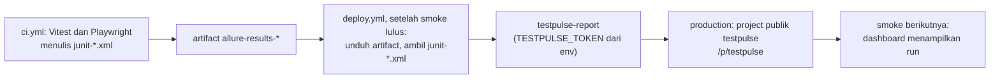

# Strategi Testing TestPulse (Tahap 1 dan 2)

Dokumen ini menjelaskan **apa** yang diuji, **di lapisan mana**, dan **kenapa**, termasuk apa yang sengaja tidak diuji. Daftar skenario per fitur ada di [test-plans/tahap-1.md](./test-plans/tahap-1.md) dan [test-plans/tahap-2.md](./test-plans/tahap-2.md); keputusan arsitektur yang memengaruhi strategi ini ada di [adr/](./adr/).

## 1. Prinsip

1. **Uji aturan di lapisan terendah yang bisa membuktikannya.** Aturan murni (role, admin terakhir, slug, kedaluwarsa undangan) diuji sebagai unit; perilaku yang butuh database asli diuji sebagai integration; hanya alur lintas-layar yang diuji E2E. Piramida tetap lebar di bawah dan sempit di atas.
2. **Risiko menentukan kedalaman, bukan jumlah halaman.** Bagian yang gagalnya merugikan (otorisasi, sesi, race condition) mendapat banyak lapisan; bagian kosmetik hanya satu.
3. **Test harus independen dan paralel.** Setiap test membuat datanya sendiri (email unik, project unik) lewat API/factory, tidak berbagi state, sehingga aman dijalankan paralel dan disharding di CI.
4. **Database asli, bukan mock, untuk perilaku data.** Integration test memakai Postgres sungguhan lewat Testcontainers, karena bug seperti race condition dan constraint tidak muncul di mock.
5. **Quality gate otomatis.** Coverage domain, ZAP High, audit dependensi, dan seluruh lapisan test harus hijau di CI sebelum deploy.

## 2. Lapisan test

| Lapisan | Tool | Lokasi | Yang dibuktikan |
|---|---|---|---|
| Unit | Vitest, `node --test` | `packages/shared/src`, `apps/api/src`, `apps/web/src`, `packages/reporter/src` (`*.test.ts`), `tests/unit` | Aturan domain murni, schema Zod, hashing, penyensoran log, pemilihan kunci rate limit, logika tema dan `theme-init.js` di web; **Tahap 2:** parser JUnit, `flakyScore`, cursor pagination, reporter CLI (argumen, glob, penggabungan, batas ukuran, exit code), format dan daftar bercursor di web, dan helper `buildJUnit` untuk test. Gate coverage >= 80% untuk `src/modules/**/domain` |
| Integration | Vitest + Testcontainers (Postgres asli) | `apps/api/test/integration` | Migrasi, repository, dan seluruh rute lewat `fastify.inject` dengan DB asli, termasuk uji paralel terkunci untuk aturan admin terakhir; **Tahap 2:** upload (token, 400/413/422/429, upload paralel, retensi 200 run), API baca, CRUD token, hapus run, dan paritas SQL flaky dengan `flakyScore` |
| API | Playwright `request` | `tests/api` | Kontrak HTTP dari luar proses: alur auth, validasi negatif dan boundary, dan **matriks otorisasi yang dibangkitkan dari tabel data** (`tests/api/authorization-matrix.ts`, diperluas Tahap 2 dengan baris hasil test dan token); **Tahap 2:** upload end-to-end lewat proxy nginx, pagination, dan token CI yang tidak berlaku di endpoint lain |
| Contract | Pact JS | `apps/web/test/contract` dan `packages/reporter/test/contract` (consumer), `apps/api/test/contract` (provider) | Web dan API sepakat soal bentuk request/response di setiap endpoint; **reporter adalah consumer kedua** untuk `POST runs`; perubahan sepihak membuat verifikasi provider gagal |
| E2E | Playwright (POM, custom fixtures; Chromium, Firefox, WebKit) | `tests/e2e`, `tests/pages` | Alur pengguna lintas halaman: daftar, buat project, undang, terima, hak akses per role, admin terakhir, ubah visibilitas; landing page, tema, dan responsif HP (lihat bagian 2.1); **Tahap 2:** token CI, dashboard, daftar run, detail run, flaky, dan riwayat test (lihat bagian 2.2) |
| Accessibility | `@axe-core/playwright` | dipanggil dari `tests/e2e` lewat `tests/support/a11y.ts` | Landing dan halaman utama (masuk/daftar, daftar dan buat project, ringkasan project dan dashboard, daftar run, detail run, flaky, riwayat test, pengaturan termasuk Token CI, pratinjau undangan) bebas pelanggaran `serious`/`critical` **di tema terang dan gelap** (bagian 2.1) |
| Gate CSP | listener `securitypolicyviolation` + pesan console, dipasang di fixture Playwright | `tests/support/csp.ts`, `tests/support/fixtures.ts` | Tidak ada satu pun pelanggaran Content Security Policy selama test E2E (bagian 2.1) |
| Proxy dan header | Vitest | `apps/web/test/functions` | Pages Function meneruskan request dengan benar; header keamanan nginx dan Cloudflare `_headers` identik |
| Performa | k6 (image `grafana/k6`, dipin) | `tests/perf`, job `perf` di [`ci.yml`](../.github/workflows/ci.yml) | Gate p95 upload dan baca, dan error < 1%, terhadap stack Docker (bagian 5.1) |
| Security | OWASP ZAP baseline, `pnpm audit`, Dependabot | job `zap` dan `lint-typecheck` di [`ci.yml`](../.github/workflows/ci.yml); gate di `tests/security/check-zap-report.mjs` | 0 temuan High dari ZAP, 0 dependensi high/critical; penolakan `<!DOCTYPE` (XXE) diuji di unit dan integration |
| Smoke production | Playwright, tag `@smoke` | `tests/smoke` | Setelah deploy: health, halaman masuk, login akun smoke, project publik terbuka tanpa login, dan dashboard `/p/testpulse` menampilkan run dari dogfooding (dilewati dengan pesan bila belum ada run). Hanya membaca |

### Kenapa tiap lapisan ada

- **Unit:** cepat (detik) dan menunjuk penyebab dengan tepat. Cocok untuk aturan yang punya banyak kombinasi (misalnya keputusan akses: aksi x role x visibilitas) yang mahal jika diuji lewat browser.
- **Integration:** aturan domain benar belum berarti SQL-nya benar. Lapisan ini menangkap constraint, transaksi, dan kunci baris yang hanya ada di database asli.
- **API:** memverifikasi sistem yang sudah berjalan sebagai kotak hitam (nginx, API, DB di Docker), tanpa biaya browser. Matriks otorisasi berupa **data**, sehingga menambah role atau endpoint berarti menambah baris, bukan menulis test baru, dan tidak ada kombinasi yang terlupa.
- **Contract:** web dan API dikembangkan terpisah dalam satu repo. Test API saja tidak menjamin web memakai respons dengan benar, dan E2E terlalu lambat untuk menangkap setiap penyimpangan bentuk data. Pact memeriksa batas itu langsung.
- **E2E:** dibatasi pada alur yang benar-benar butuh browser dan beberapa pengguna (context terpisah). Data awal dibuat lewat API supaya test cepat dan fokus. Tiga browser dijalankan untuk menangkap perbedaan perilaku (misalnya clipboard).
- **Accessibility:** semua form punya label terhubung dan bisa dioperasikan keyboard; axe menjaga hal itu tidak mundur.
- **Proxy dan header:** dua komponen yang tidak bisa dijalankan sama persis di CI (Cloudflare) tetap bisa diuji sebagai unit: logika proxy sebagai fungsi, dan kesetaraan header sebagai perbandingan berkas.
- **Security:** pemindaian otomatis murah, menangkap kelas masalah umum (header, kerentanan dependensi). Ini baseline, bukan pengganti pemodelan ancaman.
- **Performa (k6):** ingest sinkron (ADR 0004) memegang request dan transaksi selama parsing; tanpa gate, laporan besar bisa pelan-pelan merusak latensi tanpa ada test fungsional yang gagal. Dijalankan terhadap stack Docker supaya angkanya milik kode kita, bukan free tier.
- **Smoke:** satu-satunya lapisan yang menyentuh production sungguhan, sengaja kecil dan read-only supaya tidak mengotori data.

### 2.1 Tema, gate CSP, dan landing page

Tampilan baru (Tailwind CSS v4 + shadcn/ui, dua tema, dan landing page; lihat [ADR 0003](./adr/0003-tailwind-shadcn.md)) menambah empat hal yang diuji di lapisan E2E. Semuanya ada di `tests/e2e` dan `tests/support`.

**Aksesibilitas di dua tema.** Fixture `expectNoA11yViolationsInBothThemes` ([`tests/support/a11y.ts`](../tests/support/a11y.ts)) menjalankan `expectNoA11yViolations` di tema terang lalu gelap. Pilihan tema aplikasi tetap `"system"`; tema diganti dengan `page.emulateMedia({ colorScheme })`, dan axe baru dijalankan setelah kelas `dark` di `<html>` sesuai. Sebelum axe, helper menunggu transisi dan animasi berhingga selesai (mis. `transition-colors` saat tema berganti) agar axe tidak membaca warna di tengah transisi dan melaporkan kontras palsu. Penantian ini dibatasi 1500 ms dan animasi tak berhingga (mis. `animate-spin`) tidak ditunggu, sehingga tidak pernah menggantung; perilaku itu sendiri diuji di [`a11y-helper.spec.ts`](../tests/e2e/a11y-helper.spec.ts). Dipakai di landing ([`landing.spec.ts`](../tests/e2e/landing.spec.ts)), `/login` dan `/register` ([`auth.spec.ts`](../tests/e2e/auth.spec.ts)), daftar dan buat project serta ringkasan project (anggota dan anonim publik) ([`projects.spec.ts`](../tests/e2e/projects.spec.ts)), pengaturan dan pratinjau undangan ([`team.spec.ts`](../tests/e2e/team.spec.ts)). Kriteria sama seperti sebelumnya: 0 pelanggaran `serious`/`critical`.

**Gate CSP.** CSP production (`default-src 'self'; ... style-src 'self'; script-src 'self'; ...`, tanpa `'unsafe-inline'`, nonce, atau hash) tidak boleh dilonggarkan demi tampilan baru. Gate-nya ada di fixture `context`/`newContext` ([`tests/support/csp.ts`](../tests/support/csp.ts), [`fixtures.ts`](../tests/support/fixtures.ts)) sehingga **setiap test E2E gagal di teardown bila ada pelanggaran CSP**, di halaman mana pun yang dibuka test itu:

- Dua jalur deteksi: event `securitypolicyviolation` (init script + `exposeBinding` di setiap dokumen dan frame) dan pesan console error/warning yang menyebut Content Security Policy. Satu pelanggaran yang dilaporkan kedua jalur dihitung sekali.
- **Gagal tertutup:** bila binding tidak tersedia di suatu dokumen, init script menulis penanda dan itu dicatat sebagai pelanggaran `tp-guard-missing`, bukan guard yang diam-diam mati.
- **Pengecualian WebKit:** WebKit melaporkan `style-src-attr` setiap kali elemen `<select>` dibuat lewat script, padahal tidak ada atribut `style` (bug mesin). Pelanggaran semacam itu dikecualikan hanya untuk `<select>` tanpa atribut `style`; atribut `style` asli tetap terdeteksi. Karena pesan console WebKit untuk artefak itu tidak bisa dibedakan dari style inline asli, entri console `style-src*` selalu dibuang (event sudah meliputi halaman).
- Pelanggaran di dalam worker tidak terlihat sebagai event di `window`; hanya WebKit yang menampilkannya lewat console Playwright, jadi jalur console dipertahankan untuk kasus itu.
- Gate itu sendiri diuji di [`csp-guard.spec.ts`](../tests/e2e/csp-guard.spec.ts) dengan halaman probe yang CSP-nya disajikan lewat `page.route`.
- **Hanya bermakna di stack Docker/nginx** (dan CI `stack-tests`), karena di situlah header CSP production dipasang. Di mode dev Vite (`localhost:5173`) tidak ada header CSP sehingga gate selalu hijau; jalankan E2E terhadap `BASE_URL=http://localhost:8080` untuk membuktikan CSP.
- Satu pelanggaran nyata yang harus ditutup agar gate ini bisa hijau: zod menguji dukungan `new Function` (JIT) dan di bawah CSP tanpa `unsafe-eval` probe itu dilaporkan sebagai pelanggaran `script-src` walau errornya ditelan. Perbaikannya `config({ jitless: true })` di [`apps/web/src/lib/zod-config.ts`](../apps/web/src/lib/zod-config.ts), dimuat paling awal; jangan dihapus.

**Test tema** ([`theme.spec.ts`](../tests/e2e/theme.spec.ts)): `"system"` mengikuti `colorScheme` yang diemulasikan, termasuk saat emulasi berubah tanpa reload; pilihan Terang/Gelap lewat `ThemeToggle` tersimpan setelah reload dan menang atas sistem; tanpa kedip (kelas `dark` sudah terpasang sebelum bundle React dimuat, karena `theme-init.js` dimuat sinkron); `localStorage` yang melempar error atau nilai `tp-theme` tak dikenal diperlakukan sebagai sistem; `<meta name="theme-color">` mengikuti tema; pemilih tema dapat dioperasikan dengan keyboard; dan perilaku menu mobile pada viewport 375x812 (tanpa scroll horizontal).

**Test landing** ([`landing.spec.ts`](../tests/e2e/landing.spec.ts)): semua bagian tampil untuk anonim di `/` tanpa dialihkan; tombol Daftar dan Lihat demo mengarah ke `/register` dan `/p/testpulse`; link Allure/CI/Source/Strategi memiliki `href` persis dan `target="_blank"` dengan `rel` aman; kartu dashboard Tahap 2 "Tersedia" dan badge "Segera" hanya pada fitur Tahap 3 sampai 5 (roadmap: Tahap 2 Live, Tahap 3 Berikutnya); pengguna yang masuk melihat "Project saya" (bukan landing); status auth memuat dan galat sesi (503) tidak merender landing dan tidak mengalihkan; logout dari `/` berakhir di `/login`; tanpa scroll horizontal di 375 px.

### 2.2 Tahap 2: hasil test, reporter, dan dogfooding

Tahap 2 menambah fitur yang datanya berasal dari luar aplikasi (laporan JUnit dari CI). Skenario lengkap ada di [test-plans/tahap-2.md](./test-plans/tahap-2.md); keputusan di [ADR 0004](./adr/0004-ingest-sinkron-dan-definisi-flaky.md).

**Data uji.** Test API dan E2E tidak memakai fixture XML statis. Helper `buildJUnit` ([`tests/support/junit.ts`](../tests/support/junit.ts), diuji di [`tests/unit`](../tests/unit)) membangun laporan dari daftar kasus (status, `retries` untuk test flaky, pesan), dan `TestApi` ([`tests/support/api-client.ts`](../tests/support/api-client.ts)) membuat token lalu mengunggah dengan Bearer, tanpa cookie. Satu test membuat project, token, dan run miliknya sendiri, sehingga tetap independen dan paralel.

**Dua lapis untuk aturan inti.** Parser JUnit dan `flakyScore` adalah fungsi murni dengan unit test padat (semua contoh spec bagian 6 dan kasus tepi, dan di dalam gate coverage domain); perilaku database diuji di integration test dengan Postgres asli, termasuk **paritas**: skor dari query SQL harus sama dengan `flakyScore` pada pola hasil acak-terkendali. Upload paralel, retensi serentak, dan 20.000 testcase juga dibuktikan di database asli, bukan diasumsikan.

**Reporter sebagai consumer kontrak.** Selain web, `packages/reporter` menulis pact untuk `POST runs`; provider API memverifikasi kedua pact terhadap API dan Postgres asli di job `contract` yang sama. CLI-nya diuji sebagai unit (argumen, glob, penggabungan, batas 5 MB, exit code 0/1/2) dengan `fetch` palsu, dan pernah dijalankan manual terhadap stack Docker.

**UI dashboard.** Dashboard, daftar run, detail run, daftar flaky, riwayat test, dan Token CI memakai halaman yang di-lazy-load. Semuanya diuji sebagai pengunjung anonim (project publik), anggota per role, dan non-anggota (project privat tampil "tidak ditemukan"), di dua tema, di 375 px (termasuk nama branch, pesan, dan nama test yang sangat panjang), dan di bawah gate CSP. Grafik tren adalah SVG buatan sendiri dengan alternatif teks; status selalu punya ikon atau teks, tidak hanya warna. Konfirmasi hapus run berupa blok inline, bukan dialog, karena dialog dilarang oleh batasan CSP ([ADR 0003](./adr/0003-tailwind-shadcn.md)).

**Dogfooding.** TestPulse menguji dirinya sendiri dan melaporkan hasilnya ke dirinya sendiri:

- Vitest sudah menulis JUnit di setiap job (`junit-<paket>-<job>.xml`); Playwright menulisnya hanya saat `CI` diset (`junit-api.xml`, `junit-e2e-<shard>.xml`, ditentukan variabel `JUNIT_NAME` per langkah agar API dan tiap shard tidak saling menimpa). Output lokal tidak berubah.
- Konfigurasi JUnit Playwright disengaja: `includeProjectInTestName` supaya test yang sama di Chromium, Firefox, dan WebKit menjadi tiga test, bukan satu test dengan "percobaan ulang"; `includeRetries` supaya test yang lulus setelah retry tertulis sebagai `flakyFailure` (konvensi Surefire yang dikenali parser) dan menjadi flaky di dashboard.
- Job `report` di `ci.yml` membuang `junit-api.xml` dan `junit-e2e-*.xml` sebelum `allure generate`: test Playwright sudah dilaporkan `allure-playwright` (JSON), dan pembaca JUnit Allure akan menghitungnya dua kali. File JUnit Vitest tetap dipakai karena itu satu-satunya sumber untuk test Vitest. Dogfooding membaca artifact, bukan laporan Allure, jadi tidak terpengaruh.
- Langkah di [`deploy.yml`](../.github/workflows/deploy.yml) berjalan **setelah** smoke, `continue-on-error`, dan dilewati dengan `::warning::` bila secret `TESTPULSE_TOKEN` kosong atau deploy dipicu manual (tidak ada run CI pemicu). Token hanya melewati environment, tidak ada di daftar secret wajib, dan tidak pernah dicetak. Langkah membuat token ada di [deploy.md](./deploy.md), Langkah 12.
- Smoke production `dashboard project testpulse menampilkan hasil run dari CI` menutup lingkarannya: lulus bila `/p/testpulse` menampilkan minimal satu run, dilewati (dengan pesan) bila belum ada. Ia sengaja tidak gagal sebelum dogfooding pertama.

**Performa.** Bagian 5.1.

## 3. Risiko utama dan cakupannya

| Risiko | Dampak | Cara dicakup | Lokasi |
|---|---|---|---|
| **Kebocoran keberadaan project privat** (membedakan "privat" dari "tidak ada") | Orang luar bisa menebak slug project | Bukan anggota mendapat `404 PROJECT_NOT_FOUND` identik untuk project privat dan yang tidak ada; badan respons dibandingkan sama persis. UI menampilkan pesan yang sama | `tests/api/authorization.spec.ts`, `apps/api/test/integration/projects.int.test.ts`, `tests/e2e/projects.spec.ts`, unit `permissions.test.ts` |
| **Race condition admin terakhir** | Dua request paralel sama-sama lolos, project tanpa admin | Transaksi dengan `SELECT ... FOR UPDATE` pada membership admin. Test memaksa konkurensi: kedua request lolos pengecekan akses lebih dulu, lalu harus diserialkan; hasilnya tepat satu sukses dan satu `409 LAST_ADMIN` | `apps/api/test/integration/members.int.test.ts` (kasus "paralel terkunci"), unit `admins.test.ts` |
| **Otorisasi salah di salah satu kombinasi role x endpoint** | Eskalasi hak | Matriks otorisasi dibangkitkan dari data (6 aktor x endpoint yang terikat project, yaitu baris tabel spec bagian 7), plus urutan pengecekan (anonim selalu 401 di endpoint wajib login) | `tests/api/authorization-matrix.ts`, `tests/api/authorization.spec.ts` |
| **CSRF** | Aksi atas nama user dari situs lain | Lapis berganda: `SameSite=Lax`, wajib `Content-Type: application/json` pada body, pemeriksaan header `Origin` terhadap `APP_ORIGIN` | `apps/api/test/integration/security.int.test.ts` ("proteksi CSRF dan header") |
| **Keamanan sesi** | Pembajakan atau penyalahgunaan sesi | Token acak 32 byte, DB hanya menyimpan hash SHA-256, cookie `HttpOnly`/`SameSite`/`Secure`, sesi kedaluwarsa ditolak dan dibersihkan, logout menghapus baris sesi dan hanya sesi yang dipakai | `apps/api/test/integration/auth.int.test.ts`, unit `tokens.test.ts` |
| **Kerahasiaan token undangan** | Undangan dipakai pihak lain | Hanya hash di DB, token mentah tidak tersimpan, URL berisi token disensor dari log, undangan sekali pakai (accept serentak: tepat satu sukses) | `apps/api/test/integration/invitations.int.test.ts`, `apps/api/test/integration/logging.int.test.ts`, unit `logging.test.ts` |
| **Bypass rate limit lewat header IP palsu** | Brute force login | Kunci rate limit memakai `x-tp-client-ip` (diisi Pages Function dari `CF-Connecting-IP`) hanya jika header `x-proxy-secret` cocok (`PROXY_SECRET`, perbandingan `timingSafeEqual`); selain itu memakai IP koneksi langsung. `X-Forwarded-For` tidak pernah dibaca untuk kunci, sehingga perantara yang mengubahnya tidak berpengaruh. Secret tidak boleh masuk log | `apps/api/test/integration/security.int.test.ts`, `apps/api/src/http/client-ip.test.ts`, `apps/web/test/functions/proxy.test.ts` |
| **Enumerasi akun lewat login** | Mengetahui email terdaftar | Pesan `INVALID_CREDENTIALS` identik untuk email tak terdaftar dan password salah; scrypt tetap dijalankan terhadap hash dummy | `apps/api/test/integration/auth.int.test.ts`, `tests/api/auth.spec.ts` |
| **Header keamanan berbeda antar-lingkungan (drift)** | Production kurang terlindungi dibanding yang diuji ZAP | Test membandingkan `security-headers.conf` (nginx) dengan `_headers` (Cloudflare Pages): empat header yang sama, nilai sama persis | `apps/web/test/functions/headers.test.ts` |
| **Drift kontrak web dan API** | UI rusak diam-diam setelah perubahan API | Pact consumer menulis kontrak, provider memverifikasinya terhadap API asli dengan state yang disiapkan; keduanya berjalan di job CI yang sama | `apps/web/test/contract`, `apps/api/test/contract` |
| **Aksesibilitas** | Halaman tidak bisa dipakai pengguna pembaca layar atau keyboard, atau kontras gagal di salah satu tema | axe pada landing, halaman masuk/daftar, daftar dan buat project, ringkasan, pengaturan, serta undangan, **di tema terang dan gelap**; label terhubung di semua input | `tests/e2e`, `tests/support/a11y.ts` |
| **Tampilan melonggarkan CSP** (komponen UI menyuntikkan `<style>` atau atribut `style`) | Production kehilangan perlindungan CSP, atau halaman rusak di bawah CSP | Gate CSP di fixture E2E: test gagal bila ada pelanggaran CSP; bermakna di stack Docker/nginx (bagian 2.1) | `tests/support/csp.ts`, `tests/e2e/csp-guard.spec.ts`, [ADR 0003](./adr/0003-tailwind-shadcn.md) |
| **XXE dan entity expansion lewat laporan JUnit** (Tahap 2) | Pembacaan berkas lokal atau server kehabisan memori lewat dokumen berbahaya | Parser menolak `<!DOCTYPE` sebelum parsing dan tidak pernah me-resolve entity eksternal; reporter menolak dokumen yang sama sebelum mengunggah | `apps/api/src/modules/results/domain/junit.test.ts`, `apps/api/test/integration/ingest.int.test.ts`, `tests/api/results.spec.ts`, `packages/reporter/src/cli.test.ts` |
| **Kebocoran token CI** (Tahap 2) | Siapa pun yang memegang token bisa menulis ke project | Token `tp_` + 32 byte acak, ditampilkan sekali, database hanya menyimpan SHA-256; tidak ada di daftar token, di log (`authorization` disensor), atau di keluaran reporter, bahkan bila server memantulkannya; token hanya berlaku di endpoint upload project pemiliknya, cookie tidak berlaku di endpoint itu; pencabutan langsung membuat upload 401 | `apps/api/test/integration/tokens.int.test.ts`, `ingest.int.test.ts`, `logging.int.test.ts`, `tests/api/tokens.spec.ts`, `packages/reporter/src/cli.test.ts` |
| **Upload menghabiskan penyimpanan atau CPU** (Tahap 2) | Free tier Neon/Render penuh atau lambat | Batas 5 MB per body (413 sebelum parsing), 20.000 testcase per laporan, retensi 200 run per project (juga saat upload serentak), 10 token aktif per project, 60 upload per jam per token (kunci = hash token); gate k6 menjaga p95 | `ingest.int.test.ts` (5 MB, 20.000, retensi, 429), `tokens.int.test.ts`, `tests/perf` |
| **ReDoS lewat laporan JUnit** (Tahap 2) | Satu upload 5 MB menahan CPU proses API berjam-jam (semua request lain macet) | Regex pada input tak tepercaya tidak punya kuantifier bertetangga atau bersarang atas kelas yang tumpang tindih; nilai `time` dibatasi 32 karakter sebelum dicek. Test mengukur waktu parse nilai `time` 1.000.000 digit (< 100 ms) dan upload yang sama lewat API | `apps/api/src/modules/results/domain/junit.test.ts`, `ingest.int.test.ts`, `packages/reporter/src/args.test.ts` |
| **Query daftar flaky mahal pada skala maksimum** (Tahap 2) | 200 run x 20.000 hasil per project: window function atas jutaan baris, dashboard lambat dan koneksi pool tertahan | Cache LRU di memori (500 entri) per project + branch, dipakai ulang hanya bila run terbaru dan jumlah run branch itu tidak berubah (upload dan hapus run otomatis membatalkannya); query baca berat (flaky, stats, riwayat, detail run) berjalan dengan `statement_timeout` 5 detik dan menjawab `503` bila terlampaui. Batas yang diterima: tampilan pertama setelah tiap upload tetap menghitung penuh, dan cache per proses (Ruling F-I1, [ADR 0004](./adr/0004-ingest-sinkron-dan-definisi-flaky.md)) | `results-read.int.test.ts` (cache hit, invalidasi upload/hapus, 503), `apps/api/src/http/errors.test.ts`, `lru-cache.test.ts` |
| **Penyalahgunaan upload dibatasi per token saja** (Tahap 2) | Pemegang beberapa token (maks. 10 per project) bisa mengunggah hingga 10 x 60 upload per jam; tidak ada plafon per IP atau per pengguna | Diterima untuk saat ini (Ruling F-m3): runner CI sering berbagi IP sehingga plafon per IP akan memblokir pengguna sah; token hanya dibuat admin project dan bisa dicabut | `ingest.int.test.ts` (429 per token) |
| **Skor flaky di SQL menyimpang dari definisinya** (Tahap 2) | Dashboard menampilkan angka yang tidak sesuai rumus yang didokumentasikan | Rumus ada sebagai fungsi murni dan sebagai query SQL; test paritas membandingkan keduanya pada pola acak-terkendali; contoh spec bagian 6 diuji di unit | `apps/api/src/modules/results/domain/flaky.test.ts`, `apps/api/test/integration/results-read.int.test.ts` |
| **Upload paralel menghasilkan duplikat atau 500** (Tahap 2) | Data ganda, statistik salah | Upsert `test_cases` dalam satu transaksi dengan run dan hasilnya; test mengunggah laporan sama berurutan berbeda secara paralel | `ingest.int.test.ts` |
| **Pagination kehilangan atau menggandakan data** (Tahap 2) | Run terlewat di daftar atau di UI | Cursor `(created_at, id)` buram; test untuk `created_at` kembar dan selisih mikrodetik; UI mengabaikan hasil basi | `results-read.int.test.ts`, `apps/web/src/lib/cursorList.test.ts`, `tests/e2e/runs.spec.ts` |
| **Dogfooding merusak deploy atau membocorkan token** (Tahap 2) | Deploy gagal karena langkah opsional, atau secret tercetak | Langkah setelah smoke, `continue-on-error`, dilewati dengan `::warning::` tanpa token; token hanya lewat environment; kedua workflow dilint dengan actionlint | `.github/workflows/deploy.yml`, bagian 2.2 |

## 4. Data dan lingkungan test

- **Data:** dibuat per test lewat factory (`@faker-js/faker`, `tests/support/data.ts`) dan klien API (`tests/support/api-client.ts`). Tidak ada seed global untuk test API/E2E.
- **Isolasi E2E:** pengguna berbeda memakai browser context berbeda (admin, anggota, pengunjung anonim).
- **Lingkungan:** unit tanpa dependensi eksternal; integration dan contract memakai container Postgres sementara; API dan E2E berjalan terhadap stack Docker Compose (nginx + API + Postgres) yang sama dengan yang dipakai pengembang lokal; smoke berjalan terhadap production.
- **Rate limit pada test:** stack lokal/test memakai `RATE_LIMIT_MAX=1000` agar suite paralel tidak terkena 429; production memakai default 10 per menit. Perilaku 429 dibuktikan di integration test dengan batas 10. Upload memakai batas sendiri, `INGEST_RATE_LIMIT_MAX` (default 60 per jam per token; stack test menaikkannya): test API memeriksa header `x-ratelimit-*` dan 429 upload dibuktikan di integration test dengan batas 3.
- **Flaky:** CI memakai `retries: 2`; test yang lulus setelah retry ditandai flaky di laporan Allure, bukan disembunyikan, dan (Tahap 2) tercatat sebagai `flakyFailure` di JUnit yang diunggah ke dashboard TestPulse sendiri.

## 5. Pelaporan dan quality gate

Setiap job CI menulis hasil ke `allure-results`; job `report` menggabungkan semuanya menjadi satu laporan Allure yang dipublikasikan ke GitHub Pages dari `main`: <https://safeqq.github.io/testpulse/>. Mulai Tahap 2, JUnit dari job yang sama juga diunggah ke project publik `testpulse` di production oleh `deploy.yml` (dogfooding, bagian 2.2), sehingga hasilnya terlihat di dashboard TestPulse sendiri: `/p/testpulse`. Pipeline lengkap ada di [`ci.yml`](../.github/workflows/ci.yml) dan deploy di [`deploy.yml`](../.github/workflows/deploy.yml).

| Gate | Ambang | Ditegakkan oleh |
|---|---|---|
| Lint dan typecheck | 0 error | `pnpm lint`, `pnpm typecheck` |
| Dependensi | 0 high/critical | `pnpm audit --audit-level high` |
| Coverage domain | >= 80% (lines, branches, functions, statements) | Vitest coverage `thresholds` di `apps/api/vitest.config.ts` |
| Unit, integration, contract, API, E2E | semua lulus | job `unit`, `integration`, `contract`, `stack-tests` |
| ZAP baseline | 0 temuan High | `tests/security/check-zap-report.mjs` (dites di `check-zap-report.test.mjs`) |
| Performa stack Docker | p95 upload < 1500 ms, p95 baca < 300 ms, error < 1% | job `perf` (k6), bagian 5.1 |
| Smoke production | semua lulus setelah deploy (dashboard `/p/testpulse` boleh dilewati sebelum dogfooding pertama) | `deploy.yml` |

### Jumlah test (snapshot per commit `0606543`, 2026-10-31)

Angka ini adalah **snapshot**: hasil menjalankan suite secara lokal pada commit tersebut (ditambah satu test smoke dari perubahan dogfooding), dan akan bergeser seiring pengembangan. Unit, integration, dan contract dihitung dari jumlah test yang dilaporkan Vitest; API, E2E, dan smoke dari `playwright test --list` per project. Angka terbaru ada di laporan Allure dan run CI terakhir. Angka yang sama untuk Integration, API, Contract (consumer), dan E2E dicantumkan di bagian "Dibangun dengan standar QA" pada landing page (`apps/web/src/pages/landing/Quality.tsx`); perbarui keduanya bersamaan.

| Suite | Jumlah test |
|---|---|
| Unit: `packages/shared` | 53 |
| Unit: `apps/api` | 284 |
| Unit: `apps/web` (tema dan `theme-init.js` 34, Pages Function 18, paritas header 6, lainnya 29: klien API, format, navigasi, daftar bercursor, `index.html`) | 87 |
| Unit: `packages/reporter` | 57 |
| Unit: `tests/unit` (builder JUnit) | 7 |
| Security: `tests/security` (gate ZAP) | 6 |
| Integration (`apps/api`, Postgres Testcontainers) | 206 |
| Contract: consumer (web 40, reporter 2) | 42 test (satu interaksi per test) |
| Contract: provider (API) | 2 test, masing-masing memverifikasi satu pact (web dan reporter) |
| API (Playwright, termasuk matriks otorisasi) | 318 |
| E2E (Playwright) | 122 skenario per browser, dijalankan di 3 browser (a11y-helper 1, auth 12, csp-guard 15, dashboard 8, fonts 2, forced-colors 3, landing 12, projects 16, runs 23, team 10, theme 14, tokens 6) |
| Smoke production (`@smoke`) | 5 |
| Performa (k6) | 2 skenario (`ingest`, `read`), bukan test per kasus |

### 5.1 Performa (k6)

Job CI `perf` (setelah `stack-tests`) menjalankan dua skenario k6 terhadap stack Docker Compose, bukan production. Image dipin (`grafana/k6:1.3.0`) agar versi baru tidak mengubah gate diam-diam. Data disiapkan oleh [`tests/perf/setup.mjs`](../tests/perf/setup.mjs) lewat API: satu pengguna, satu project publik berisi 55 run (500 test per run) untuk skenario baca, dan satu project untuk skenario upload dengan beberapa token yang dipakai bergiliran per VU, sehingga batas upload per token tidak tercapai dan tidak ada 429.

| Skenario | Beban | Threshold (gate) |
|---|---|---|
| `ingest` ([`ingest.js`](../tests/perf/ingest.js)) | 5 VU x 30 detik, upload laporan JUnit 500 test | p95 durasi < 1500 ms |
| `read` ([`read.js`](../tests/perf/read.js)) | 10 VU x 30 detik, `stats`, `runs`, `flaky` | p95 durasi < 300 ms |
| keduanya | | `http_req_failed` < 1%, `checks` rate > 0,99 (respons diperiksa isinya, bukan hanya status), `http_reqs` per skenario count > 0 (gagal tertutup bila skenario tidak menghasilkan sampel, mis. tertimpa flag CLI) |

Ringkasan JSON k6 diunggah sebagai artifact `k6-summary`. Threshold mengikuti spec Tahap 2 bagian 11; produksi tetap memakai batas upload default 60/jam/token (compose menaikkannya hanya untuk stack test).

## 6. Sengaja tidak diuji (dan alasannya)

| Hal | Alasan | Rencana |
|---|---|---|
| Performa free tier (Render cold start, Neon) | Angka dari free tier tidak bermakna; k6 sengaja hanya menyasar stack Docker (bagian 5.1) | Dicatat sebagai keterbatasan |
| Visual regression | UI masih berubah cepat; screenshot baseline sekarang akan terus rusak tanpa nilai | Tahap 3 |
| Mutation testing | Perlu suite yang sudah stabil dan domain yang lebih besar | Tahap 4 |
| Alur email (reset password, verifikasi) | Fiturnya sengaja tidak ada di tahap 1; undangan berupa link yang disalin manual | Tidak direncanakan |
| Perilaku edge Cloudflare (cache, TLS, routing) | Tidak bisa direplikasi di CI. Yang bisa diuji (logika Pages Function, kesetaraan header) diuji sebagai unit; sisanya dicek lewat smoke test production | Smoke test |
| Ganti slug, ganti email/password, OAuth, 2FA | Di luar lingkup tahap 1 (spec bagian 4) | Tahap berikut sesuai kebutuhan |
| Notifikasi, lampiran/screenshot test, perbandingan dua run, mute test flaky, format selain JUnit, ekspor data | Di luar lingkup tahap 2 (spec Tahap 2 bagian 14) | Tahap berikut sesuai kebutuhan |
| Pengujian penetrasi manual | ZAP baseline hanya pemindaian pasif otomatis, bukan pengganti uji penetrasi | Di luar lingkup portfolio |
| Beban pada Render/Neon free tier (cold start, batas koneksi) | Dikendalikan penyedia; didokumentasikan jujur di [deploy.md](./deploy.md) | Dicatat sebagai keterbatasan |

## 7. Keterbatasan yang diketahui

- ZAP baseline bersifat pasif; ia tidak menjalankan serangan aktif atau alur yang butuh login.
- Gate CSP hanya efektif bila E2E berjalan terhadap nginx dengan header CSP production (stack Docker dan job CI `stack-tests`); di dev server Vite ia tidak punya yang dijaga. Ia juga tidak memverifikasi header Cloudflare Pages secara langsung, melainkan mengandalkan paritas `_headers` dan `security-headers.conf` (`headers.test.ts`).
- Screenshot di `docs/images` hanya dokumentasi, bukan baseline visual regression.
- E2E berjalan di stack lokal dengan rate limit longgar, bukan di production; yang menyentuh production hanya smoke test.
- Smoke test bergantung pada satu akun khusus dan satu project publik yang didaftarkan manual (lihat [deploy.md](./deploy.md)). Smoke dashboard baru bermakna setelah pemilik repo membuat `TESTPULSE_TOKEN` (deploy.md, Langkah 12); sebelumnya ia dilewati, bukan gagal.
- Dogfooding hanya mengunggah JUnit dari artifact CI yang masih ada (retensi 7 hari) dan hanya untuk run yang memicu deploy (bukan deploy manual); gate k6 mengukur stack Docker di runner CI, bukan production.
